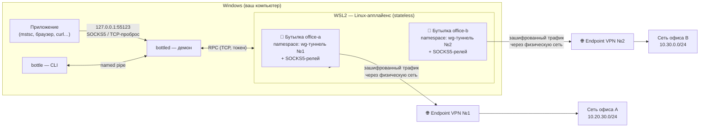

# BottleForApps

**Несколько VPN одновременно на одном компьютере — так, чтобы они друг о друге не знали.**

Каждый VPN живёт в собственном изолированном сетевом окружении («бутылке») внутри лёгкой Linux-виртуальной машины: свой сетевой стек, своя таблица маршрутов, свой DNS. Наружу бутылка отдаёт локальный SOCKS5-прокси и TCP-пробросы портов на `127.0.0.1` — подключайтесь к RDP, браузером или любым приложением, а куда уйдёт трафик решает бутылка, а не таблица маршрутов Windows.

> Если коротко: два офисных WireGuard/OpenVPN, корпоративная тестовая сеть и чей-то ещё VPN — все подняты одновременно, каждый со своей маршрутизацией и DNS, и ни один не перехватывает трафик соседа и не ломает ваш основной интернет.

---

## Содержание

- [Как это работает](#как-это-работает)
- [Статус проекта](#статус-проекта)
- [Требования](#требования)
- [Установка на Windows](#установка-на-windows)
- [Установка на macOS](#установка-на-macos)
- [Быстрый старт за 5 минут](#быстрый-старт-за-5-минут)
- [Формат профиля бутылки](#формат-профиля-бутылки)
- [Host-бутылки (фирменные VPN-клиенты)](#host-бутылки-фирменные-vpn-клиенты)
- [Работа с программой](#работа-с-программой)
- [Сценарии работы](#сценарии-работы)
- [Диагностика и восстановление](#диагностика-и-восстановление)
- [Безопасность](#безопасность)
- [Ограничения текущей версии](#ограничения-текущей-версии)
- [Сборка из исходников](#сборка-из-исходников)
- [Устройство репозитория](#устройство-репозитория)
- [Дорожная карта](#дорожная-карта)

---

## Как это работает

BottleForApps состоит из трёх частей: утилита командной строки `bottle`, фоновый демон `bottled` в вашей сессии Windows и лёгкий Linux-«апплайенс» внутри WSL2 (встроенная в Windows 10/11 виртуализация — работает даже на Home-редакции). Для [host-бутылок](#host-бутылки-фирменные-vpn-клиенты) добавляется четвёртая, необязательная часть — служба маршрутов `bottle-svc`.



Ключевые свойства:

1. **Изоляция конструктивная.** Каждая бутылка — отдельный network namespace Linux: собственная таблица маршрутов, собственный DNS, собственный маршрут по умолчанию. VPN-клиенты физически не видят друг друга: kill switch, DNS и default route одного туннеля не могут затронуть соседний.
2. **Трафик уходит через «изначальную» сеть.** Виртуальная машина WSL2 выходит в интернет через NAT вашего физического адаптера (Wi-Fi/Ethernet). Endpoint каждого VPN подключается напрямую через провайдера, а не через соседний туннель.
3. **Точка входа — localhost.** Все сервисы бутылки (SOCKS5, пробросы для RDP) слушают только `127.0.0.1` — снаружи компьютера ничего не видно.
4. **Без драйверов и прав администратора.** Туннели поднимаются userspace-реализациями (wireguard-go, OpenVPN) внутри Linux-VM: ни одного драйвера ядра Windows, антивирусам нечего блокировать. Права администратора нужны один раз — при включении компонента WSL (и ещё один раз, `bottle-svc --install`, если нужны host-бутылки).

Поддерживаются конфигурационные VPN-протоколы: **WireGuard** и **OpenVPN** (файлы `.conf`/`.ovpn`) — внутри env-бутылок, — и **фирменные GUI-клиенты вендоров** (Cisco AnyConnect, FortiClient и т.п.) в host-ботылках на хосте, параллельно с env-бутылками: см. [Host-бутылки](#host-бутылки-фирменные-vpn-клиенты).

---

## Статус проекта

| Возможность | Статус |
|---|---|
| Env-бутылки: WireGuard + OpenVPN из конфигов, одновременный запуск | ✅ работает (M1) |
| SOCKS5-прокси и TCP-пробросы на 127.0.0.1 (RDP и любые TCP-приложения) | ✅ работает (M1) |
| CLI: `list / show / start / stop / status` | ✅ работает (M1) |
| Автоматический импорт и обновление Linux-апплайенса | ✅ работает (M1) |
| Host-бутылки: фирменные GUI-клиенты (AnyConnect и др.) на хосте + служба маршрутов `bottle-svc` | ✅ работает (M2) |
| Авто-восстановление env-бутылок после сна/`wsl --shutdown`, живучесть (health-цикл) | ✅ работает (M2) |
| Параллельные CLI-команды во время длинного `start` | ✅ работает (M2) |
| Установка одним MSI (служба + WSL + PATH, один UAC) и portable-zip без админа | ✅ работает (M3) |
| Управление профилями из CLI: `create` / `delete` | ✅ работает (M3) |
| Диагностика: `bottle doctor`, файловые журналы, `bottle logs export` | ✅ работает (M3) |
| Обновление аплаенса `bottle upgrade`; чистка маршрутов `bottle routes cleanup` | ✅ работает (M3) |
| Графический интерфейс | 🔜 M4 |
| Поддержка macOS | 🔜 M4 |

Готовые сборки (MSI и portable-zip) публикуются на [странице релизов](../../releases) по тегам версий; сборку ведёт CI (джобы `release-build` + `install-smoke`), версия 0.2.0 соответствует завершённому M3. Версия 1 проекта (C#/.NET, маршрутная схема без виртуализации, macOS + Windows) сохранена в ветке [`v1`](../../tree/v1) и теге `v1-mvp`.

---

## Требования

- **Windows 10/11** (подходит Home-редакция — Hyper-V не требуется).
- **WSL2** — компонент Windows, включается одной командой (см. установку).
- Права администратора — **только один раз**, для включения WSL (и ещё один раз — `bottle-svc --install`, если нужны [host-бутылки](#host-бутылки-фирменные-vpn-клиенты)). Для повседневной работы BottleForApps прав администратора не требует.
- Файл конфигурации VPN (WireGuard `.conf` или OpenVPN `.ovpn`) либо установленный фирменный VPN-клиент (для host-бутылок).

---

## Установка на Windows

Два способа, оба ведут к одному: [MSI](#вариант-1-msi-полная-установка) — рекомендуемый, portable-zip — без прав администратора. Сборка из исходников — [раздел для разработчиков](#сборка-из-исходников).

> Установщики не подписаны сертификатом (осознанно, до покупки подписи): SmartScreen покажет предупреждение — «Подробнее → Выполнить в любом случае». Контрольные суммы релизов — в `SHA256SUMS.txt` рядом с файлами.

### Вариант 1: MSI (полная установка)

Один запрос UAC ставит всё: файлы в `Program Files\BottleForApps`, PATH, службу маршрутов `bottle-svc` (для host-бутылок) и включает компоненты WSL (без дистрибутива).

1. Скачайте `BottleForApps-<версия>-win-x64.msi` со [страницы релизов](../../releases) и запустите.
2. Если установщик включал WSL и система просит перезагрузку — перезагрузитесь.
3. Запустите демон: откройте **новое** окно PowerShell (PATH обновился) и выполните `bottled` (при первом запуске демон сам импортирует Linux-аплаенс).

Проверка окружения: `bottle doctor` — все строки зелёные или предупреждения с пояснениями.

### Вариант 2: portable (без прав администратора)

1. Скачайте `BottleForApps-portable-<версия>-win-x64.zip`, распакуйте в любой каталог.
2. WSL должен быть включён в системе **заранее** (`wsl --install --no-distribution` от администратора один раз; portable сам WSL не ставит).
3. Запустите `bottled.exe` из каталога распаковки.

Ограничения portable: только env-бутылки (WireGuard/OpenVPN). Для host-бутылок запустите от администратора `bottle-svc.exe --install` из того же каталога. Подробности — в `INSTALL.txt` внутри архива.

### Автозапуск демона (необязательно)

Автозапуск по умолчанию выключен. Включается вручную: ярлык `bottled.exe` в `shell:startup` (Win+R → `shell:startup`) со свойством «Окно: свёрнутое». Демон не показывает интерфейса и не мешает работе.

### Обновление и удаление (MSI)

- **Обновление** — запустите MSI новой версии поверх старой (major upgrade: файлы и служба заменяются; профили в каталоге данных не трогаются). Даунгрейд отвергается — сначала удалите новую версию.
- **Обновление Linux-аплаенса** — `bottle upgrade` (останавливает бутылки по требованию; профили сохраняются).
- **Удаление** — «Панель управления → Приложения → BottleForApps»: файлы, PATH и служба убираются; ваш каталог данных с профилями остаётся.

---

## Установка на macOS

**Рабочая поддержка macOS появится в milestone M4** (порт Linux-аплаенса на встроенную виртуализацию macOS — Virtualization.framework). Что доступно уже сейчас:

- **Сборка и разработка**: проект полностью компилируется и проходит тесты на macOS — `cargo build`, `cargo test` работают (см. [сборку из исходников](#сборка-из-исходников)).
- **Утилита `bottle`** на macOS сознательно отвечает:

```text
$ bottle list
bottle работает только на Windows (демон недоступен на этой платформе)
```

- **Версия 1** приложения (ветка [`v1`](../../tree/v1)) работала на macOS Apple Silicon по маршрутной схеме без виртуализации — можно пользоваться ею, пока не вышел M4.

---

## Быстрый старт за 5 минут

Демон запущен (см. установку). Предположим, у вас есть файл WireGuard `office-a.conf` для сети офиса, в которой стоит RDP-сервер `10.20.30.15`.

### 1. Создайте бутылку

```powershell
bottle create office-a --name "Офис А" --kind env --protocol wireguard ^
    --config C:\путь\к\office-a.conf ^
    --forward 10.20.30.15:3389 --dns 10.20.30.1
```

Демон скопирует конфиг в хранилище (`%LOCALAPPDATA%\BottleForApps\bottles\`, секреты недоступны другим пользователям) и запишет профиль TOML. Всё можно проверить: `bottle show office-a`; занятый id перезаписывается только с `--force`.

<details>
<summary>Без CLI: профиль руками</summary>

Профиль — файл `bottles\office-a.toml`; конфиг кладётся рядом как `office-a.conf`:

```toml
id = "office-a"
name = "Офис А"
kind = "env"

[vpn]
protocol = "wireguard"
config = "office-a.conf"

[expose]
socks5 = 0
forwards = [{ listen = 0, target = "10.20.30.15:3389" }]
dns = "10.20.30.1"
```

> `socks5 = 0` и `listen = 0` означают «выбрать порт автоматически». Порт узнаете в `bottle status` после запуска.

</details>

### 2. Запустите бутылку

```powershell
bottle start office-a
```

Демон поднимет namespace с туннелем (первый запуск включает WSL-VM — до минуты; дальше — секунды), дождётся WireGuard-handshake и откроет слушатели. В случае успеха:

```text
Бутылка office-a поднята
```

### 3. Проверьте состояние

```text
C:\> bottle status
office-a  up
  socks5 127.0.0.1:55123
  rdp 10.20.30.15:3389 → 127.0.0.1:55124
```

Читается так: бутылка `office-a` поднята; SOCKS5 доступен на порту `55123`; RDP-сервер офиса — на локальном порту `55124`.

### 4. Подключитесь

**RDP:**

```powershell
mstsc /v:127.0.0.1:55124
```

**Браузер через VPN офиса** (настройте прокси SOCKS5 `127.0.0.1:55123`, либо проверьте curl'ом):

```powershell
curl.exe --socks5 127.0.0.1:55123 https://api.ipify.org
```

вернёт публичный IP, с которого офисная сеть видит вас.

### 5. Остановите, когда не нужно

```powershell
bottle stop office-a
```

Туннель, namespace и слушатели будут полностью разобраны.

---

## Формат профиля бутылки

Профиль — файл TOML `<каталог-данных>\bottles\<id>.toml`. Идентификатор: строчные латинские буквы, цифры и дефис (`office-a`, `test-stand-2`), не может начинаться с дефиса; зарезервированные имена Windows (`con`, `nul`, `com1`…) запрещены.

```toml
# --- обязательные поля ---
id = "office-a"              # латиница/цифры/дефис, совпадает с именем файла
name = "Офис А"              # человекочитаемое имя, любое
kind = "env"                 # "env" — изолированное окружение (единственный вид в M1)

[vpn]
protocol = "wireguard"       # "wireguard" | "openvpn"
config = "office-a.conf"     # имя файла конфига В КАТАЛОГЕ bottles/

# --- что бутылка отдаёт наружу ---
[expose]
socks5 = 0                   # порт SOCKS5 на 127.0.0.1; 0 = выбрать автоматически
forwards = [                 # TCP-пробросы: локальный порт → адрес внутри VPN-сети
  { listen = 0, target = "10.20.30.15:3389" },       # RDP-сервер офиса
  { listen = 0, target = "rds.office-a.local:3389" }, # DNS-имя резолвит бутылка через DNS VPN
]
dns = "10.20.30.1"           # DNS-сервер внутри VPN (для имён вида *.office-a.local)
launch = "mstsc"             # команда Windows, запускаемая после подъёма (необязательно)
```

Правила и значения по умолчанию:

| Поле | Обязательное | По умолчанию | Комментарий |
|---|---|---|---|
| `id` | да | — | валидируется; имя файла = `id` |
| `name` | да | — | показывается в `list` |
| `kind` | да | — | только `"env"` в M1 |
| `vpn.protocol` | да | — | `wireguard` или `openvpn` |
| `vpn.config` | да | — | положите файл рядом с профилем |
| `expose.socks5` | нет | `0` (авто) | фиксированный порт: 1–65535 |
| `expose.forwards` | нет | `[]` | `listen = 0` — автоподбор |
| `expose.dns` | нет | DNS копируется из VM | обычно внутренний DNS компании |
| `expose.launch` | нет | — | запускается без аргументов |

Автоподбор портов ведётся из диапазона 49152–65535; выбранные порты закрепляются на время работы бутылки и видны в `bottle status`.

Профиль для OpenVPN выглядит так же — `protocol = "openvpn"` и `config = "office.ovpn"`; конфиг используется как есть (включая `redirect-gateway` и маршруты из него).

---

## Host-бутылки (фирменные VPN-клиенты)

Некоторые корпоративные VPN работают только через фирменный клиент вендора — его нельзя запустить в изолированном окружении. Для них существует второй вид бутылок: **host-бутылка** запускает фирменный клиент на хосте как есть, а BottleForApps берёт на себя сетевую обвязку вокруг него:

- держит **точечные маршруты** (`/32`/`/128`) до endpoint'ов клиента через шлюз физической сети — чтобы подключение клиента не ушло в чужой VPN-туннель, если тот захватил default route;
- после запуска клиента дожидается появления его VPN-адаптера (до 120 с);
- поднимает привычные SOCKS5/TCP-пробросы на `127.0.0.1`, привязанные к VPN-адаптеру клиента, — RDP и прочие инструменты подключаются так же, как к env-бутылкам;
- каждые 30 с перепроверяет DNS endpoint'ов: новые адреса получают маршруты, старые живут до остановки бутылки.

Host-бутылки и env-бутылки работают одновременно — конфиг-VPN и фирменный клиент не мешают друг другу.

### Установка службы маршрутов (один раз)

Точечные маршруты требуют прав, которых у демона нет. Их добавляет и убирает штатная служба Windows `bottle-svc` (имя в реестре `BottleForAppsRouteHelper`, автозапуск, LocalSystem). Установите её один раз из **PowerShell от имени администратора**:

```powershell
C:\Tools\BottleForApps\bottle-svc.exe --install
```

Проверка: `sc.exe query BottleForAppsRouteHelper` → `RUNNING`. Служба умеет только добавлять/удалять/сверять точечные маршруты (в `ActiveStore` — после перезагрузки таблица чиста) и ничего не запускает; её журнал: `%PROGRAMDATA%\BottleForApps\routes.jsonl`. Удаление: `bottle-svc --uninstall`, отладка без SCM: `--console`.

Без установленной службы `bottle start` host-бутылки завершается понятной ошибкой: «Служба маршрутов BottleForApps не установлена — host-бутылки недоступны (bottle-svc --install от администратора)».

### Формат host-профиля

```toml
id = "corp-vpn"
name = "Корп VPN"
kind = "host"

[vpn]
client = 'C:\Program Files\Vendor\vpn.exe'  # исполняемый файл клиента
args = "connect office"                     # аргументы запуска (необязательно)
endpoints = ["vpn.example.com"]             # VPN-шлюзы клиента (DNS-имена или IP)
interface = "Corp VPN Adapter"              # имя адаптера (необязательно)

[expose]
socks5 = 0
forwards = [{ listen = 0, target = "10.50.10.15:3389" }]
```

| Поле | Обязательное | Комментарий |
|---|---|---|
| `vpn.client` | да | путь к exe фирменного клиента; клиенту не передаётся управление |
| `vpn.args` | нет | аргументы запуска (кавычки поддерживаются) |
| `vpn.endpoints` | да | адреса VPN-шлюзов — по ним ставятся точечные маршруты |
| `vpn.interface` | нет | имя VPN-адаптера; без него — единственный новый Up-адаптер (несколько новых → ошибка с подсказкой задать поле) |
| `[expose]` | — | тот же формат, что у env-бутылок (`socks5`/`forwards`/`launch`); `dns` не используется |

Остальные правила — как у [формата профиля](#формат-профиля-бутылки): `id`/`name`, автоподбор портов, `bottle start/stop/status` без отличий.

### Ограничения host-бутылок

- **Kill switch вендора.** Опция клиента «блокировать трафик без VPN» может мешать соседним VPN (в т.ч. env-бутылкам) — это фильтр вендора на стороне Windows. Если конфликтует — отключите опцию в клиенте.
- **Клиент не останавливается автоматически.** У вендорских клиентов нет API завершения: `bottle stop` убирает маршруты и слушатели, а клиент остаётся работать (CLI печатает предупреждение) — остановите его вручную.
- **Один экземпляр фирменного клиента.** Большинство клиентов односессийны: не заводите две host-бутылки на один и тот же клиент.

---

## Работа с программой

Утилита `bottle` общается с демоном через именованный канал. Реальная справка:

```text
C:\> bottle --help
BottleForApps — управление бутылками

Usage: bottle <COMMAND>

Commands:
  list     Список бутылок в хранилище
  show     Показать профиль и состояние бутылки
  start    Поднять бутылку (туннель + SOCKS5 + пробросы)
  stop     Опустить бутылку
  status   Состояние поднятых бутылок
  doctor   Диагностика окружения (WSL, аплаенс, служба, порты)
  create   Создать бутылку из профиля
  delete   Удалить бутылку (профиль и конфиг из хранилища)
  logs     Журналы диагностики
  routes   Маршруты host-бутылок
  upgrade  Пере-импорт аплаенса (снос дистрибуции WSL + импорт из rootfs)
  help     Print help

Options:
  -h, --help     Print help
  -V, --version  Print version
```

### `bottle list` — все профили

```text
C:\> bottle list
id         name                kind  state
office-a   Офис А              env   up
office-b   Офис B              env   -
test-std   Тестовый стенд      env   failed (туннель не поднялся: handshake timeout)
```

Колонка `state`: `up` — поднята; `-` — остановлена; `failed (причина)` — не поднялась.

### `bottle show <id>` — детали одной бутылки

```text
C:\> bottle show office-a
id:      office-a
name:    Офис А
kind:    env
vpn:     wireguard, config: office-a.conf
expose:
  socks5: авто
  forwards:
    10.20.30.15:3389 → 127.0.0.1:авто
  dns: 10.20.30.1
  launch: mstsc
runtime:
  office-a  up
    socks5 127.0.0.1:55123
    rdp 10.20.30.15:3389 → 127.0.0.1:55124
```

Блок `runtime` появляется только у поднятых бутылок. У ошибок запуска показывается причина.

### `bottle start <id>` / `bottle stop <id>`

```powershell
bottle start office-a    # до минуты при холодном старте WSL, секунды — на тёплом
bottle stop office-a     # полный разбор туннеля и слушателей
```

Успех `stop` печатает `Бутылка office-a опущена`. Повторный `start` уже поднятой бутылки безвреден (предупреждение, состояние не меняется). `stop` остановленной — аналогично. `start` host-бутылки от WSL не зависит: демон ждёт появления VPN-адаптера клиента (до 120 с), а ответ `stop` host-бутылки дополняется предупреждением, что фирменный клиент оставлен запущенным.

### `bottle status` — только поднятые

```text
C:\> bottle status
office-a  up
  socks5 127.0.0.1:55123
  rdp 10.20.30.15:3389 → 127.0.0.1:55124
office-b  up
  socks5 127.0.0.1:55201
  rdp 10.30.0.20:3389 → 127.0.0.1:55202
```

### `bottle create` / `bottle delete` — управление профилями

```powershell
# env-бутылка из конфига WireGuard/OpenVPN
bottle create office-a --name "Офис А" --kind env --protocol wireguard `
    --config C:\conf\office-a.conf `
    [--socks5 1080] [--forward 10.20.30.15:3389 …] [--dns 10.20.30.1] [--launch mstsc] [--force]

# host-бутылка (фирменный клиент)
bottle create corp --name "Корп" --kind host `
    --vpn "C:\Program Files\Vendor\vpn.exe" [--vpn-args "connect office"] `
    --endpoint vpn.example.com [--vpn-interface "Vendor Adapter"]

bottle delete office-a    # отказ, если бутылка поднята
```

Создание проверяет профиль (env — `--protocol` и `--config`; host — `--vpn` и минимум один `--endpoint`) и отказывает на занятый id без `--force`. Удаление сносит профиль и копию конфига из хранилища (исходный файл у вас не трогается).

### `bottle doctor` — диагностика окружения

```text
C:\> bottle doctor          # сразу после MSI-установки, бутылок ещё не было
✓ wsl              WSL включён, дистрибуций: 1
⚠ appliance        Аплаенс не импортирован — импортируется при первом старте бутылки
✓ service          Служба маршрутов установлена — host-бутылки доступны
⚠ agent            Агент аплаенса недоступен — аплаенс не импортирован (нормально до первого старта)
✓ profiles         Профили читаются: 0
✓ ports            Фиксированных портов в профилях нет
```

После первого `bottle start` строки appliance/agent становятся `✓` (например, `✓ agent  Агент аплаенса отвечает (версия 0.2.0)`); отдельная строка `wsl-networking` появляется только при mirrored-режиме сети. Doctor ничего не меняет в системе — проверяет, не будит WSL-виртуальную машину.

`⚠` — допустимое состояние (portable без службы, аплаенс до первого старта), `✗` — требует действий (включить WSL, убрать `networkingMode=mirrored` из `.wslconfig`, обновить аплаенс). Код возврата: 0 без `✗`, 1 при любом.

### `bottle logs export` — выгрузка журналов

```powershell
bottle logs export [--dest C:\tmp\logs.zip]
```

Демон собирает ZIP: свои журналы (`<каталог данных>\logs`), журналы службы (`%PROGRAMDATA%\BottleForApps\logs`) и сводку `system.txt` — версии, состояния бутылок, профили **без содержимого конфигов**. Журналы пишутся файлами (ротация ежедневно, хранение 30 дней). Архив содержит IP-адреса, имена интерфейсов и endpoint'ы — **просмотрите содержимое перед отправкой** кому-либо.

### `bottle routes cleanup` / `bottle upgrade`

```powershell
bottle routes cleanup   # снять сиротские маршруты через службу (крах демона и т.п.)
bottle upgrade          # пере-импорт Linux-аплаенса из rootfs
```

`upgrade` отказывает при поднятых бутылках, сносит только дистрибуцию WSL `bottleforapps` (профили в каталоге данных не трогаются, токен пересоздаётся) и пере-импортирует аплаенс — в ответе старая и новая версии.

### Демон `bottled`

```text
использование: bottled [--data-dir <PATH>] [--rootfs <PATH>]
```

| Флаг | По умолчанию | Смысл |
|---|---|---|
| `--data-dir` | `%LOCALAPPDATA%\BottleForApps` | профили, токен, образ аплаенса |
| `--rootfs` | `<data-dir>\appliance\…`, затем `<каталог exe>\appliance\…` | Linux-образ для импорта в WSL; цепочка покрывает MSI (Program Files) и portable (рядом с exe) |

Второй экземпляр демона не запускается («Демон BottleForApps уже запущен»). Остановка — `Ctrl+C` в его окне; поднятые бутылки будут корректно разобраны.

---

## Сценарии работы

### Сценарий 1. Два офиса одновременно, RDP в каждый

Классическая боль: VPN-клиент офиса A захватывает default route, и VPN офиса B больше не может подключиться. В BottleForApps туннели изолированы по построению.

1. Положите в `bottles\` два профиля: `office-a.toml` + `office-a.conf`, `office-b.toml` + `office-b.conf` (в каждом — свой проброс к RDP-серверу).
2. `bottle start office-a` и `bottle start office-b`.
3. `bottle status` покажет две поднятые бутылки и пары портов.
4. Подключитесь двумя окнами `mstsc` к соответствующим `127.0.0.1:<порт>`. Обе сессии работают одновременно; интернет на компьютере идёт как обычно, через физическую сеть.
5. Внутри каждой RDP-сессии имена резолвятся собственным DNS бутылки (если задан `expose.dns`) — имена вида `sql.office-a.local` не «утекут» в офис B.

### Сценарий 2. Браузер через корпоративную сеть, остальное — напрямую

Нужно открыть внутренний портал, не включая VPN на всю систему.

1. Профиль с `socks5 = 0` (или фиксированным портом), пробросы не нужны.
2. `bottle start office-a`.
3. В браузере (удобно — в отдельном профиле браузера) настройте прокси **SOCKS5** `127.0.0.1:55123`. Firefox поддерживает это штатно; для Chrome/Edge есть расширения типа FoxyProxy.
4. Внутренние сайты открываются через VPN, всё остальное идёт напрямую. Проверка: `curl --socks5 127.0.0.1:55123 https://api.ipify.org` — внешний IP теперь «офисный».

### Сценарий 3. Разработчик: тестовый контур + прод заказчика

На тестовом стенде — WireGuard команды разработки, в проде — OpenVPN заказчика, и оба нужны одновременно (базы, CI, документация).

1. Два профиля: `test-stand.toml` (wireguard) и `customer-prod.toml` (openvpn).
2. Оба стартуют одновременно; у каждого — SOCKS5 и пробросы к нужным сервисам:

```toml
[expose]
forwards = [
  { listen = 0, target = "10.99.0.5:5432" },   # база тестового стенда
  { listen = 0, target = "10.99.0.7:8080" },   # CI
]
```

3. В конфигах инструментов укажите `127.0.0.1:<порт из status>` — например, строка подключения к PostgreSQL меняется с `10.99.0.5:5432` на `127.0.0.1:55131`.

### Сценарий 4. Конфиг-VPN + фирменный клиент одновременно

Корпоративная сеть доступна только через Cisco AnyConnect/FortiClient, а параллельно нужен WireGuard-конфиг (свой сервер, стенд заказчика). Оба поднимаются одновременно и не конфликтуют.

1. Установите службу маршрутов ([инструкция выше](#установка-службы-маршрутов-один-раз)) — один раз от администратора.
2. Два профиля: `office-wg.toml` (`kind = "env"`, конфиг WireGuard) и `corp-vpn.toml` (`kind = "host"`, AnyConnect-клиент; формат — [выше](#формат-host-профиля)).
3. `bottle start office-wg` и `bottle start corp-vpn` — в любом порядке.
4. Фирменный клиент подключается через физическую сеть (точечные маршруты держит служба), WireGuard живёт в своей бутылке; интернет работает как обычно.
5. Подключайтесь: RDP корпоративной сети — через проброс host-бутылки, ресурсы стенда — через SOCKS5 env-бутылки.

### Сценарий 5. «Всё сломалось» — восстановление

- **Бутылка не поднимается (`failed`)** — `bottle show <id>` покажет причину. Типовые: недоступен endpoint (проверьте интернет), истёк конфиг, firewall режет UDP.
- **Перезагружали компьютер или выполняли `wsl --shutdown`** — env-бутылки восстановятся сами: демон замечает смерть аплаенса (health-цикл 10 с) и пере-поднимает их с бэкоффом, обычно до ~2 минут. Следить удобно `bottle status` (метка `Degraded` — идёт восстановление). Host-бутылка с живым VPN-адаптером не трогается вовсе.
- **Подозрение на мусор в WSL** — `wsl -d bottleforapps -- ip netns list` покажет активные namespace'ы бутылок; после корректного `stop` список пуст. Полный сброс аплаенса: `wsl --unregister bottleforapps` (демон пересоздаст его при следующем старте; перед этим удалите файл `appliance-token` в каталоге данных, чтобы не осталось «потерянного» токена).

Подробнее — [чеклист проверки M1](docs/checklists/m1-verification.md), [чеклист приёмки M2](docs/checklists/m2-verification.md) (в т.ч. destructive-проверки: kill демона/службы, `wsl --shutdown`, параллельные CLI) и [чеклист релизной приёмки M3](docs/checklists/m3-verification.md) (чистая машина: MSI → первая бутылка без ручных шаманств).

---

## Диагностика и восстановление

| Симптом | Что проверить |
|---|---|
| `Не удалось подключиться к демону` | запущен ли `bottled.exe` (окно должно быть открыто) |
| `start` долго думает при первом запуске | это импорт WSL-образа — до минуты, последующие запуски быстрые |
| `failed (туннель не поднялся: handshake timeout)` | endpoint VPN недоступен; проверьте конфиг и связь с офисом |
| `Служба маршрутов BottleForApps не установлена…` (start host-бутылки) | установите службу: `bottle-svc.exe --install` из PowerShell от администратора |
| `bottle status` показывает `Degraded` | аплаенс недоступен (сон, `wsl --shutdown`); авто-восстановление уже идёт — обычно до ~2 минут, вручную ничего делать не нужно |
| `start` «завис» на ~60 с и завершился ошибкой | аплаенс завис (агент не отвечает): демон дожидается таймаутов RPC и честно падает; помогает `wsl --shutdown` и повторный `start` |
| Маршруты host-бутылки ведут себя странно | журнал службы `%PROGRAMDATA%\BottleForApps\routes.jsonl`; живые маршруты: `Get-NetRoute` |
| Порт из `status` не открывается | бутылка остановлена (`bottle status`); либо порт занят — укажите другой в профиле |
| Хочу начать с чистого листа | `wsl --unregister bottleforapps` + удалить каталог данных + перезапуск демона |

Журналы пишутся файлами (JSONL, ротация ежедневно, хранение 30 дней): демон — `<каталог данных>\logs`, служба — `%PROGRAMDATA%\BottleForApps\logs`. Выгрузка всего сразу: `bottle logs export`. Технические подробности архитектуры — в [спецификации](docs/superpowers/specs/2026-09-30-bottleforapps-v2-design.md).

---

## Безопасность

- **Секреты под защитой**: конфиги VPN хранятся только в вашем каталоге данных (доступ исключён для других пользователей), внутри виртуальной машины существуют лишь в оперативной памяти (tmpfs) и исчезают при остановке бутылки. Ключи никогда не пишутся в журналы.
- **Управляющий канал** демона и агента защищён случайным 256-битным токеном; слушатели доступны только с вашего компьютера (`127.0.0.1`).
- **Аплаенс stateless**: без конфигурации внутри, ничего не отправляет наружу, телеметрии нет.
- Изолированные окружения не могут выполнить произвольные команды на хосте: интерфейс агента ограничен подъёмом/разбором namespace'ов.

---

## Ограничения текущей версии

Честный список границ M3:

1. **Фирменные клиенты управляются ограниченно**: kill switch вендора может конфликтовать со вторым VPN, клиент не останавливается командой `stop`, один экземпляр клиента на host-бутылку (подробнее — [Host-бутылки → Ограничения](#ограничения-host-бутылок)).
2. **UDP-приложения не ретранслируются** — SOCKS5 используется в режиме TCP (RDP-клиент Windows сам переходит на TCP; браузеры и большинство инструментов работают по TCP).
3. **После сна/рестарта WSL env-бутылки восстанавливаются автоматически** — но не мгновенно: диагностика и повторные попытки занимают до ~2 минут (`Degraded` в `bottle status` — норма на это время).
4. **Автозапуск демона не включается установщиком** (осознанно): ярлык в `shell:startup` ставится вручную (см. установку).
5. **Установщики не подписаны** — SmartScreen предупреждает; подпись кода появится после покупки сертификата (шаг подписи в релизной джобе подготовлен).
6. **MSI поверх ручной `bottle-svc --install`** откажет с текстом «служба уже установлена» — снимите службу (`bottle-svc --uninstall`) и повторите MSI.
7. **Только Windows.** macOS — M4.

---

## Сборка из исходников

Требуются Rust (rustup, stable) и, для сборки Linux-образа, Docker.

```bash
# тесты и линтеры
cargo fmt --all --check
cargo clippy --workspace --all-targets -- -D warnings
cargo test --workspace

# бинарники Windows (демон, CLI, служба маршрутов для host-бутылок)
cargo build --release -p daemon -p cli -p svc

# Linux-апплайенс (артефакт artifacts/bottleforapps-rootfs.tar.gz)
bash appliance/build-rootfs.sh
```

`bottle-svc.exe` дополнительно устанавливается как служба Windows — один раз, от администратора (`bottle-svc --install`, см. [Host-бутылки](#установка-службы-маршрутов-один-раз)).

Интеграционные тесты агента требуют Linux и root — на macOS и в обычном запуске Windows они пропускаются и исполняются в CI (`agent-integration`). Проверить компиляцию под Windows без самой Windows: `cargo check -p daemon -p cli -p svc --target x86_64-pc-windows-msvc`. Детали сборки аплаенса — [appliance/README.md](appliance/README.md).

---

## Устройство репозитория

```
crates/
  core/        # домен: TOML-профили, RPC-протоколы, кадрирование (length-prefixed JSON)
  relay-lib/   # data-plane: SOCKS5-сервер и TCP-пробросы
  agent/       # bottle-agent — root-исполнитель в Linux-аплаенсе: namespace'ы, туннели, relay
  daemon/      # bottled — демон Windows: хранилище, named-pipe, WSL, оркестрация бутылок
  svc/         # bottle-svc — служба маршрутов Windows (host-бутылки)
  cli/         # bottle — тонкий CLI
appliance/     # сборка Linux-образа (Dockerfile + overlay + скрипт)
installer/     # WiX-проект MSI
scripts/       # CI-сценарии и portable-сборка
docs/          # спецификация, план, чеклист приёмки
```

Проектирование велось от спецификации: [дизайн-документ](docs/superpowers/specs/2026-09-30-bottleforapps-v2-design.md), [план milestone M0+M1](docs/superpowers/plans/2026-09-30-bottleforapps-v2-m0-m1.md) и [план M2](docs/superpowers/plans/2026-10-01-bottleforapps-v2-m2.md). Приёмка milestone'ов — чеклистами [M1](docs/checklists/m1-verification.md) и [M2](docs/checklists/m2-verification.md).

---

## Дорожная карта

| Этап | Содержание |
|---|---|
| **M1** ✅ | env-бутылки WireGuard/OpenVPN, SOCKS5 + пробросы, CLI, stateless-апплайенс |
| **M2** ✅ | host-бутылки для фирменных клиентов (привилегированная служба маршрутов), авто-восстановление, живучесть, параллельный CLI |
| **M3** ✅ | установщики MSI + portable, `create`/`delete`/`upgrade`/`doctor`/`logs export`/`routes cleanup`, файловые журналы |
| **M4** | графический интерфейс (Tauri), поддержка macOS (встроенная виртуализация) |

История версии 1 — ветка `v1`, тег `v1-mvp`.
