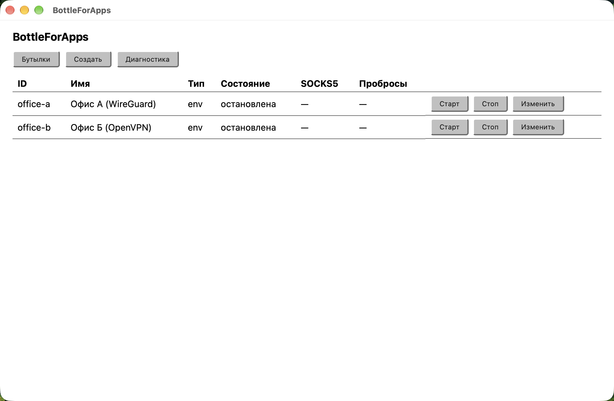
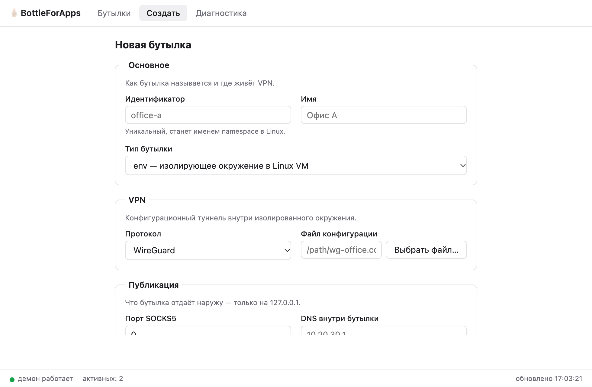
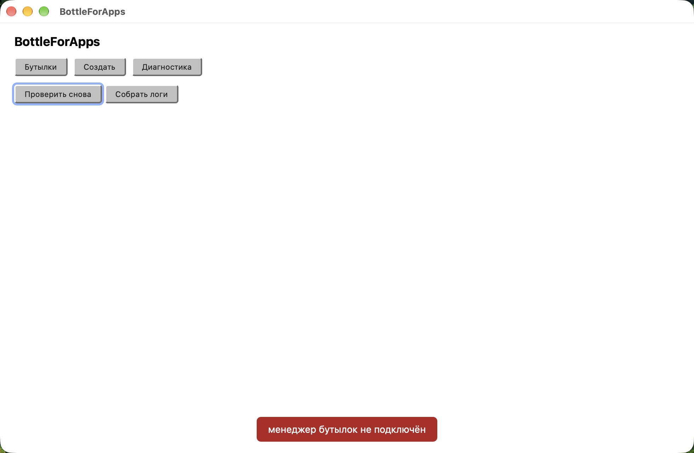
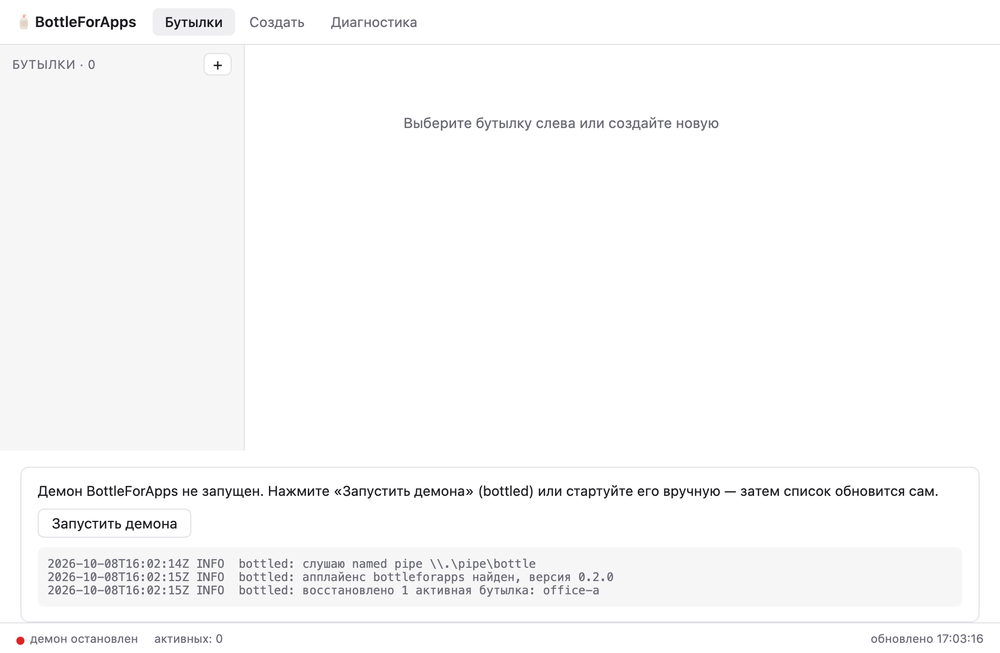

<div align="center">

# 🍾 Погребок

**Несколько VPN одновременно на одном компьютере — так, чтобы они друг о друге не знали.**

[](../../releases)
[](../../actions)


</div>

---

Каждый VPN живёт в собственной **бутылке** — изолированном Linux network namespace внутри WSL2: свой сетевой стек, своя таблица маршрутов, свой DNS. Наружу бутылка отдаёт SOCKS5-прокси и TCP-пробросы на `127.0.0.1` — куда уйдёт трафик, решает бутылка, а не таблица маршрутов Windows. Без драйверов, без перехвата чужого трафика, без прав администратора в повседневной работе.

Управление — из графического приложения **«Погребок»**: оно — источник истины. Профили, конфиги и логины/пароли бутылок хранятся в зашифрованной базе (SQLCipher) под мастер-паролем; демон получает их от приложения по защищённому каналу с токеном сессии и ничего не держит на диске.



## Возможности

| | |
|---|---|
| 🧪 **Бутылки env и host** | WireGuard/OpenVPN в WSL2 (env) и фирменные клиенты на хосте (host) — в соседних вкладках, работают одновременно |
| 🔐 **Зашифрованное хранилище** | SQLCipher под мастер-паролем: конфиги, логины, пароли. Без пароля приложение не откроется |
| 🎛 **GUI — источник истины** | запуск и остановка демона, консоль состояний, модальное создание бутылки — всё из главного окна |
| 📋 **Диагностика** | карты состояния (демон, WSL, служба, БД), Doctor, «Собрать логи», живая консоль событий с уровнями и датами |
| 🖥 **Трей** | закрытие окна прячет приложение в трей — демон живёт; «Завершить» спросит подтверждение и остановит всё |
| 🚀 **Без лишних технологий** | всё нужное ставится установщиком или лежит в portable-zip |

## Требования

- Windows 10/11 (подходит Home — Hyper-V не нужен) с включённым **WSL2**.
- Права администратора один раз — на включение WSL (и ещё один раз — `pogrebok-svc --install`, если нужны host-бутылки).
- Конфиг WireGuard (`.conf`) или OpenVPN (`.ovpn`), либо фирменный VPN-клиент (Cisco AnyConnect, FortiClient и т.п.).

## Установка

Готовые сборки — на [странице релизов](../../releases) (собираются CI по тегам версий). Установщики не подписаны сертификатом: SmartScreen предупредит — «Подробнее → Выполнить в любом случае». Контрольные суммы — в `SHA256SUMS.txt` рядом с файлами.

- **MSI (рекомендуется)** — `Pogrebok-<версия>-win-x64.msi`: один UAC ставит приложение, демона, служебный CLI, службу маршрутов, PATH и включает компоненты WSL. Если система просила перезагрузку после включения WSL — перезагрузитесь.
- **Portable** — `Pogrebok-portable-<версия>-win-x64.zip`: распаковать и запустить `pogrebok-gui.exe`. WSL должен быть включён заранее (`wsl --install --no-distribution` от администратора); только env-бутылки, пока не выполнен `pogrebok-svc.exe --install` от администратора.

Обновление — MSI новой версии поверх старой; обновление Linux-апплайенса — `pogrebok upgrade`. Удаление — «Приложения → Погребок», база данных в каталоге данных остаётся.

> **Переход с 0.2.x (BottleForApps):** при первом запуске приложение само найдёт профили старой версии (`%LOCALAPPDATA%\BottleForApps\bottles\`) и предложит перенести их в зашифрованную базу. Старые файлы не удаляются.

## Быстрый старт

1. Запустите **«Погребок»** из меню «Пуск». При первом запуске задайте **мастер-пароль** — без него приложение не откроет базу бутылок.
2. Нажмите **«Запустить демона»** — демон поднимется из приложения; бутылки видны в списке всегда, даже когда демон остановлен.
3. **«Создать»**: в модальном окне поверх главного выберите файл `.conf`/`.ovpn`, задайте имя — конфиг уйдёт в зашифрованную базу.
4. Нажмите **«Старт»** у бутылки (первый запуск включает WSL-VM — до минуты, дальше секунды).
5. Подключайтесь: RDP — `mstsc /v:127.0.0.1:<порт>`, браузер — SOCKS5 `127.0.0.1:<порт>`; адреса копируются из карточки бутылки одним нажатием.

| Создание бутылки | Диагностика | Демон не запущен |
|---|---|---|
|  |  |  |

## Приложение

- **Вкладки Env / Host** — бутылки разделены по типу: env (WireGuard/OpenVPN в WSL) и host (фирменные клиенты).
- **Карточка бутылки** — единая сетка команд: старт/стоп, редактировать, обновить логин и пароль, удалить; адреса SOCKS5/пробросов копируются в один клик.
- **Диагностика** — карты состояния (демон, WSL, служба, БД), Doctor, «Собрать логи» и живая консоль событий: уровни (debug/info/warn/error/fatal), дата, код события и описание; логируются операции демона, команды GUI и службы.
- **Трей** — закрытие окна прячет приложение в трей (демон продолжает работать); «Завершить» в меню трея спросит подтверждение и остановит и приложение, и демона.
- **Настройки** — тема, автозапуск демона, горячие клавиши.

## Служебный CLI

`pogrebok` — только служебные команды: `doctor` — диагностика окружения (WSL, апплайенс, служба, порты); `logs export` — ZIP с журналами; `upgrade` — пере-импорт Linux-апплайенса; `routes cleanup` — чистка сиротских маршрутов. Управление бутылками (create/list/start/stop/…) в 0.3 живёт только в приложении: CLI на эти команды отвечает подсказкой-навигацией. Все команды понимают `--json`. Полная справка — `pogrebok --help`.

OpenVPN-конфиги с голым `auth-user-pass`: логин и пароль хранятся в зашифрованной базе (кнопка **«Обновить логин и пароль»** у бутылки); демон получает их от приложения и держит только в памяти сессии и в tmpfs внутри WSL-апплайенса.

## Host-бутылки

Для VPN, которые работают только через фирменный клиент (AnyConnect, FortiClient…): клиент запускается на хосте как есть, а Погребок держит точечные маршруты до его шлюзов (служба `pogrebok-svc`, ставится один раз: `pogrebok-svc --install` от администратора) и поднимает те же SOCKS5/пробросы на `127.0.0.1`, привязанные к VPN-адаптеру клиента. Env- и host-бутылки работают одновременно. Ограничения: «Стоп» не завершает фирменный клиент (нет API — остановите вручную), kill switch вендора может конфликтовать с соседними VPN, один экземпляр клиента на бутылку.

## Диагностика

| Симптом | Что делать |
|---|---|
| «Не удалось подключиться к демону» | кнопка «Запустить демона» в приложении |
| Первый старт долгий | импорт WSL-образа, до минуты — нормально |
| `failed (handshake timeout)` | endpoint VPN недоступен — проверьте конфиг и связь |
| `Degraded` в статусе | апплайенс переживает сон/`wsl --shutdown` — авто-восстановление до ~2 минут, ничего делать не нужно |
| Служба маршрутов не установлена | `pogrebok-svc.exe --install` из PowerShell от администратора |

Журналы — файлы JSONL с ротацией (демон — `<каталог данных>\logs`, служба — `%PROGRAMDATA%\Pogrebok\logs`, приложение — там же `gui-*.jsonl`); выгрузка одним архивом: `pogrebok logs export` или «Диагностика → Собрать логи».

## Ограничения

Только Windows (порт на macOS отложен по итогам спайка — [отчёт](spikes/vz-poc/REPORT.md); версия 1 для macOS сохранена в ветке [`v1`](../../tree/v1), тег `v1-mvp`). UDP не ретранслируется — SOCKS5 в режиме TCP (RDP и браузеры работают). Автозапуск приложения не ставится установщиком — ярлык в `shell:startup` вручную. Установщики не подписаны.

## Сборка из исходников

Нужны Rust (stable) и Docker (для Linux-образа).

```bash
cargo test --workspace                                        # тесты ядра
cargo build --release -p daemon -p cli -p svc                 # бинарники Windows
bash appliance/build-rootfs.sh                                # Linux-апплайенс → artifacts/

cd gui && npm ci
npm run lint && npm run test && npm run build                 # web-часть GUI
npm run tauri build                                           # release-сборка pogrebok-gui
```

Посмотреть UI без Windows и демона: `npm run dev` в `gui/` и открыть `http://localhost:5173/?demo=1` (демо-данные; `?demo=down` — панель «демон не запущен»).

Устройство репозитория: `crates/` — ядро (core, agent, daemon, svc, cli, relay-lib; scenario — dev-драйвер сценариев CI), `gui/` — Tauri-приложение, `appliance/` — сборка Linux-образа, `installer/` — WiX-проект MSI и NSIS-установщик, `docs/` — спецификация и чеклисты приёмки.

## Статус и дорожная карта

| Этап | Содержание |
|---|---|
| **M1–M3** ✅ | env-бутылки WireGuard/OpenVPN, SOCKS5 + пробросы, host-бутылки + служба маршрутов, авто-восстановление, MSI + portable, doctor/logs/upgrade |
| **M4A** ✅ | графический интерфейс (Tauri): список, старт/стоп, создание, диагностика, трей; GUI в установщиках |
| **0.3 «Погребок»** ✅ | GUI — источник истины; зашифрованная БД под мастер-паролем; вкладки env/host; консоль событий; модальные окна; ребрендинг |
| **M4B** ⏸ | macOS (Virtualization.framework) — отложено по итогам спайка |
