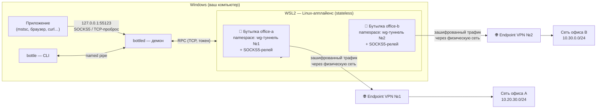

# BottleForApps

**Несколько VPN одновременно на одном компьютере — так, чтобы они друг о друге не знали.**

Каждый VPN живёт в собственном изолированном сетевом окружении («бутылке») внутри лёгкой Linux-виртуальной машины: свой сетевой стек, своя таблица маршрутов, свой DNS. Наружу бутылка отдаёт локальный SOCKS5-прокси и TCP-пробросы портов на `127.0.0.1` — подключайтесь к RDP, браузером или любым приложением, а куда уйдёт трафик решает бутылка, а не таблица маршрутов Windows.

> Если коротко: два офисных WireGuard/OpenVPN, корпоративная тестовая сеть и чей-то ещё VPN — все подняты одновременно, каждый со своей маршрутизацией и DNS, и ни один не перехватывает трафик соседа и не ломает ваш основной интернет.

---

## Содержание

- [Как это работает](#как-это-работает)
- [Статус проекта](#статус-проекта)
- [Требования](#требования)
- [Установка на Windows](#установка-на-windows)
- [Установка на macOS](#установка-на-macos)
- [Быстрый старт за 5 минут](#быстрый-старт-за-5-минут)
- [Формат профиля бутылки](#формат-профиля-бутылки)
- [Работа с программой](#работа-с-программой)
- [Сценарии работы](#сценарии-работы)
- [Диагностика и восстановление](#диагностика-и-восстановление)
- [Безопасность](#безопасность)
- [Ограничения текущей версии](#ограничения-текущей-версии)
- [Сборка из исходников](#сборка-из-исходников)
- [Устройство репозитория](#устройство-репозитория)
- [Дорожная карта](#дорожная-карта)

---

## Как это работает

BottleForApps состоит из трёх частей: утилита командной строки `bottle`, фоновый демон `bottled` в вашей сессии Windows и лёгкий Linux-«апплайенс» внутри WSL2 (встроенная в Windows 10/11 виртуализация — работает даже на Home-редакции).



Ключевые свойства:

1. **Изоляция конструктивная.** Каждая бутылка — отдельный network namespace Linux: собственная таблица маршрутов, собственный DNS, собственный маршрут по умолчанию. VPN-клиенты физически не видят друг друга: kill switch, DNS и default route одного туннеля не могут затронуть соседний.
2. **Трафик уходит через «изначальную» сеть.** Виртуальная машина WSL2 выходит в интернет через NAT вашего физического адаптера (Wi-Fi/Ethernet). Endpoint каждого VPN подключается напрямую через провайдера, а не через соседний туннель.
3. **Точка входа — localhost.** Все сервисы бутылки (SOCKS5, пробросы для RDP) слушают только `127.0.0.1` — снаружи компьютера ничего не видно.
4. **Без драйверов и прав администратора.** Туннели поднимаются userspace-реализациями (wireguard-go, OpenVPN) внутри Linux-VM: ни одного драйвера ядра Windows, антивирусам нечего блокировать. Права администратора нужны один раз — при включении компонента WSL.

Поддерживаются конфигурационные VPN-протоколы: **WireGuard** и **OpenVPN** (файлы `.conf`/`.ovpn`). Фирменные GUI-клиенты вендоров (Cisco AnyConnect, FortiClient и т.п.) появятся в следующем milestone — см. [дорожную карту](#дорожная-карта).

---

## Статус проекта

| Возможность | Статус |
|---|---|
| Env-бутылки: WireGuard + OpenVPN из конфигов, одновременный запуск | ✅ работает (M1) |
| SOCKS5-прокси и TCP-пробросы на 127.0.0.1 (RDP и любые TCP-приложения) | ✅ работает (M1) |
| CLI: `list / show / start / stop / status` | ✅ работает (M1) |
| Автоматический импорт и обновление Linux-апплайенса | ✅ работает (M1) |
| Установщик в один клик (MSI + portable) | 🔜 M3 |
| Фирменные GUI-клиенты (AnyConnect и др.) на хосте | 🔜 M2 |
| Восстановление бутылок после сна/перезапуска WSL | 🔜 M2 |
| Графический интерфейс | 🔜 M4 |
| Поддержка macOS | 🔜 M4 |

Версия 1 проекта (C#/.NET, маршрутная схема без виртуализации, macOS + Windows) сохранена в ветке [`v1`](../../tree/v1) и теге `v1-mvp`.

---

## Требования

- **Windows 10/11** (подходит Home-редакция — Hyper-V не требуется).
- **WSL2** — компонент Windows, включается одной командой (см. установку).
- Права администратора — **только один раз**, для включения WSL. Для повседневной работы BottleForApps прав администратора не требует.
- Файл конфигурации VPN (WireGuard `.conf` или OpenVPN `.ovpn`).

---

## Установка на Windows

> В milestone M3 появится установщик в один клик. Сейчас установка — из исходников, это занимает ~15 минут и не требует опыта разработки.

### Шаг 1. Включите WSL2

Откройте **PowerShell от имени администратора** и выполните:

```powershell
wsl --install --no-distribution
```

Если система попросит перезагрузку — перезагрузитесь и вернитесь сюда. Проверка:

```powershell
wsl --status
```

### Шаг 2. Установите инструменты сборки

1. **Rust** — скачайте и установите [rustup](https://rustup.rs/) (официальный установщик, всё по умолчанию).
2. **Git for Windows** — [git-scm.com](https://git-scm.com/download/win).
3. **Docker Desktop** — [docker.com](https://www.docker.com/products/docker-desktop/) — нужен один раз, чтобы собрать Linux-образ аплаенса. После установки запустите Docker Desktop и дождитесь статуса «Running».

Проверка в новом окне PowerShell:

```powershell
cargo --version ; git --version ; docker version
```

### Шаг 3. Соберите проект

```powershell
git clone <адрес-этого-репозитория> BottleForApps
cd BottleForApps
cargo build --release -p daemon -p cli
```

В `target\release` появятся `bottled.exe` (демон) и `bottle.exe` (CLI). Для удобства скопируйте их в отдельный каталог, например `C:\Tools\BottleForApps`:

```powershell
mkdir C:\Tools\BottleForApps
copy target\release\bottled.exe, target\release\bottle.exe C:\Tools\BottleForApps\
```

### Шаг 4. Соберите Linux-апплайенс

```powershell
bash appliance\build-rootfs.sh
```

Скрипт соберёт внутри Docker лёгкий Linux-образ (~9 МБ) с wireguard-go, OpenVPN и агентом, проверит его и положит результат в `artifacts\bottleforapps-rootfs.tar.gz`. Каталог `artifacts` скрипт создаёт сам.

### Шаг 5. Подготовьте каталог данных

Демон хранит профили и служебные файлы в каталоге данных (по умолчанию — `%LOCALAPPDATA%\BottleForApps`, можно переопределить флагом `--data-dir`). Скопируйте туда образ аплаенса:

```powershell
mkdir $env:LOCALAPPDATA\BottleForApps\appliance -Force
copy artifacts\bottleforapps-rootfs.tar.gz $env:LOCALAPPDATA\BottleForApps\appliance\
```

Если передаёте `--data-dir`, положите образ в `<ваш-каталог>\appliance\` — демон ищет его там по умолчанию (можно переопределить флагом `--rootfs`).

### Шаг 6. Запустите демон

```powershell
C:\Tools\BottleForApps\bottled.exe
```

Оставьте окно открытым (автозапуск службы появится в M3). При первом запуске демон сам импортирует аплаенс в WSL. Готово — переходите к [быстрому старту](#быстрый-старт-за-5-минут).

<details>
<summary>Автозапуск демона при входе в систему (необязательно)</summary>

Создайте ярлык `bottled.exe` в `shell:startup` (Win+R → `shell:startup`) со свойством «Окно: свёрнутое». Демон не показывает интерфейса и не мешает работе.

</details>

---

## Установка на macOS

**Рабочая поддержка macOS появится в milestone M4** (порт Linux-аплаенса на встроенную виртуализацию macOS — Virtualization.framework). Что доступно уже сейчас:

- **Сборка и разработка**: проект полностью компилируется и проходит тесты на macOS — `cargo build`, `cargo test` работают (см. [сборку из исходников](#сборка-из-исходников)).
- **Утилита `bottle`** на macOS сознательно отвечает:

```text
$ bottle list
bottle работает только на Windows (демон недоступен на этой платформе)
```

- **Версия 1** приложения (ветка [`v1`](../../tree/v1)) работала на macOS Apple Silicon по маршрутной схеме без виртуализации — можно пользоваться ею, пока не вышел M4.

---

## Быстрый старт за 5 минут

Демон запущен (см. установку). Предположим, у вас есть файл WireGuard `office-a.conf` для сети офиса, в которой стоит RDP-сервер `10.20.30.15`.

### 1. Создайте профиль бутылки

Профили лежат в `%LOCALAPPDATA%\BottleForApps\bottles\` (или `<--data-dir>\bottles\`). Создайте два файла:

**`bottles\office-a.toml`** — профиль:

```toml
id = "office-a"
name = "Офис А"
kind = "env"

[vpn]
protocol = "wireguard"
config = "office-a.conf"

[expose]
socks5 = 0
forwards = [{ listen = 0, target = "10.20.30.15:3389" }]
```

**`bottles\office-a.conf`** — ваш конфиг WireGuard как есть (секретный ключ внутри).

> `socks5 = 0` и `listen = 0` означают «выбрать порт автоматически». Порт узнаете в `bottle status` после запуска.

### 2. Запустите бутылку

```powershell
C:\Tools\BottleForApps\bottle.exe start office-a
```

Демон поднимет namespace с туннелем (первый запуск включает WSL-VM — до минуты; дальше — секунды), дождётся WireGuard-handshake и откроет слушатели. В случае успеха:

```text
Бутылка office-a поднята
```

### 3. Проверьте состояние

```text
C:\> bottle status
office-a  up
  socks5 127.0.0.1:55123
  rdp 10.20.30.15:3389 → 127.0.0.1:55124
```

Читается так: бутылка `office-a` поднята; SOCKS5 доступен на порту `55123`; RDP-сервер офиса — на локальном порту `55124`.

### 4. Подключитесь

**RDP:**

```powershell
mstsc /v:127.0.0.1:55124
```

**Браузер через VPN офиса** (настройте прокси SOCKS5 `127.0.0.1:55123`, либо проверьте curl'ом):

```powershell
curl.exe --socks5 127.0.0.1:55123 https://api.ipify.org
```

вернёт публичный IP, с которого офисная сеть видит вас.

### 5. Остановите, когда не нужно

```powershell
bottle stop office-a
```

Туннель, namespace и слушатели будут полностью разобраны.

---

## Формат профиля бутылки

Профиль — файл TOML `<каталог-данных>\bottles\<id>.toml`. Идентификатор: строчные латинские буквы, цифры и дефис (`office-a`, `test-stand-2`), не может начинаться с дефиса; зарезервированные имена Windows (`con`, `nul`, `com1`…) запрещены.

```toml
# --- обязательные поля ---
id = "office-a"              # латиница/цифры/дефис, совпадает с именем файла
name = "Офис А"              # человекочитаемое имя, любое
kind = "env"                 # "env" — изолированное окружение (единственный вид в M1)

[vpn]
protocol = "wireguard"       # "wireguard" | "openvpn"
config = "office-a.conf"     # имя файла конфига В КАТАЛОГЕ bottles/

# --- что бутылка отдаёт наружу ---
[expose]
socks5 = 0                   # порт SOCKS5 на 127.0.0.1; 0 = выбрать автоматически
forwards = [                 # TCP-пробросы: локальный порт → адрес внутри VPN-сети
  { listen = 0, target = "10.20.30.15:3389" },       # RDP-сервер офиса
  { listen = 0, target = "rds.office-a.local:3389" }, # DNS-имя резолвит бутылка через DNS VPN
]
dns = "10.20.30.1"           # DNS-сервер внутри VPN (для имён вида *.office-a.local)
launch = "mstsc"             # команда Windows, запускаемая после подъёма (необязательно)
```

Правила и значения по умолчанию:

| Поле | Обязательное | По умолчанию | Комментарий |
|---|---|---|---|
| `id` | да | — | валидируется; имя файла = `id` |
| `name` | да | — | показывается в `list` |
| `kind` | да | — | только `"env"` в M1 |
| `vpn.protocol` | да | — | `wireguard` или `openvpn` |
| `vpn.config` | да | — | положите файл рядом с профилем |
| `expose.socks5` | нет | `0` (авто) | фиксированный порт: 1–65535 |
| `expose.forwards` | нет | `[]` | `listen = 0` — автоподбор |
| `expose.dns` | нет | DNS копируется из VM | обычно внутренний DNS компании |
| `expose.launch` | нет | — | запускается без аргументов |

Автоподбор портов ведётся из диапазона 49152–65535; выбранные порты закрепляются на время работы бутылки и видны в `bottle status`.

Профиль для OpenVPN выглядит так же — `protocol = "openvpn"` и `config = "office.ovpn"`; конфиг используется как есть (включая `redirect-gateway` и маршруты из него).

---

## Работа с программой

Утилита `bottle` общается с демоном через именованный канал. Реальная справка:

```text
C:\> bottle --help
BottleForApps — управление бутылками

Usage: bottle <COMMAND>

Commands:
  list    Список бутылок в хранилище
  show    Показать профиль и состояние бутылки
  start   Поднять бутылку (туннель + SOCKS5 + пробросы)
  stop    Опустить бутылку
  status  Состояние поднятых бутылок
  help    Print help

Options:
  -h, --help     Print help
  -V, --version  Print version
```

### `bottle list` — все профили

```text
C:\> bottle list
id         name                kind  state
office-a   Офис А              env   up
office-b   Офис B              env   -
test-std   Тестовый стенд      env   failed (туннель не поднялся: handshake timeout)
```

Колонка `state`: `up` — поднята; `-` — остановлена; `failed (причина)` — не поднялась.

### `bottle show <id>` — детали одной бутылки

```text
C:\> bottle show office-a
id:      office-a
name:    Офис А
kind:    env
vpn:     wireguard, config: office-a.conf
expose:
  socks5: авто
  forwards:
    10.20.30.15:3389 → 127.0.0.1:авто
  dns: 10.20.30.1
  launch: mstsc
runtime:
  office-a  up
    socks5 127.0.0.1:55123
    rdp 10.20.30.15:3389 → 127.0.0.1:55124
```

Блок `runtime` появляется только у поднятых бутылок. У ошибок запуска показывается причина.

### `bottle start <id>` / `bottle stop <id>`

```powershell
bottle start office-a    # до минуты при холодном старте WSL, секунды — на тёплом
bottle stop office-a     # полный разбор туннеля и слушателей
```

Успех `stop` печатает `Бутылка office-a опущена`. Повторный `start` уже поднятой бутылки безвреден (предупреждение, состояние не меняется). `stop` остановленной — аналогично.

### `bottle status` — только поднятые

```text
C:\> bottle status
office-a  up
  socks5 127.0.0.1:55123
  rdp 10.20.30.15:3389 → 127.0.0.1:55124
office-b  up
  socks5 127.0.0.1:55201
  rdp 10.30.0.20:3389 → 127.0.0.1:55202
```

### Демон `bottled`

```text
использование: bottled [--data-dir <PATH>] [--rootfs <PATH>]
```

| Флаг | По умолчанию | Смысл |
|---|---|---|
| `--data-dir` | `%LOCALAPPDATA%\BottleForApps` | профили, токен, образ аплаенса |
| `--rootfs` | `<data-dir>\appliance\bottleforapps-rootfs.tar.gz` | Linux-образ для импорта в WSL |

Второй экземпляр демона не запускается («Демон BottleForApps уже запущен»). Остановка — `Ctrl+C` в его окне; поднятые бутылки будут корректно разобраны.

---

## Сценарии работы

### Сценарий 1. Два офиса одновременно, RDP в каждый

Классическая боль: VPN-клиент офиса A захватывает default route, и VPN офиса B больше не может подключиться. В BottleForApps туннели изолированы по построению.

1. Положите в `bottles\` два профиля: `office-a.toml` + `office-a.conf`, `office-b.toml` + `office-b.conf` (в каждом — свой проброс к RDP-серверу).
2. `bottle start office-a` и `bottle start office-b`.
3. `bottle status` покажет две поднятые бутылки и пары портов.
4. Подключитесь двумя окнами `mstsc` к соответствующим `127.0.0.1:<порт>`. Обе сессии работают одновременно; интернет на компьютере идёт как обычно, через физическую сеть.
5. Внутри каждой RDP-сессии имена резолвятся собственным DNS бутылки (если задан `expose.dns`) — имена вида `sql.office-a.local` не «утекут» в офис B.

### Сценарий 2. Браузер через корпоративную сеть, остальное — напрямую

Нужно открыть внутренний портал, не включая VPN на всю систему.

1. Профиль с `socks5 = 0` (или фиксированным портом), пробросы не нужны.
2. `bottle start office-a`.
3. В браузере (удобно — в отдельном профиле браузера) настройте прокси **SOCKS5** `127.0.0.1:55123`. Firefox поддерживает это штатно; для Chrome/Edge есть расширения типа FoxyProxy.
4. Внутренние сайты открываются через VPN, всё остальное идёт напрямую. Проверка: `curl --socks5 127.0.0.1:55123 https://api.ipify.org` — внешний IP теперь «офисный».

### Сценарий 3. Разработчик: тестовый контур + прод заказчика

На тестовом стенде — WireGuard команды разработки, в проде — OpenVPN заказчика, и оба нужны одновременно (базы, CI, документация).

1. Два профиля: `test-stand.toml` (wireguard) и `customer-prod.toml` (openvpn).
2. Оба стартуют одновременно; у каждого — SOCKS5 и пробросы к нужным сервисам:

```toml
[expose]
forwards = [
  { listen = 0, target = "10.99.0.5:5432" },   # база тестового стенда
  { listen = 0, target = "10.99.0.7:8080" },   # CI
]
```

3. В конфигах инструментов укажите `127.0.0.1:<порт из status>` — например, строка подключения к PostgreSQL меняется с `10.99.0.5:5432` на `127.0.0.1:55131`.

### Сценарий 4. «Всё сломалось» — восстановление

- **Бутылка не поднимается (`failed`)** — `bottle show <id>` покажет причину. Типовые: недоступен endpoint (проверьте интернет), истёк конфиг, firewall режет UDP.
- **Перезагружали компьютер или выполняли `wsl --shutdown`** — демон мог не заметить. Выполните `bottle stop <id>` и заново `bottle start <id>` (автоматическое восстановление — в M2).
- **Подозрение на мусор в WSL** — `wsl -d bottleforapps -- ip netns list` покажет активные namespace'ы бутылок; после корректного `stop` список пуст. Полный сброс аплаенса: `wsl --unregister bottleforapps` (демон пересоздаст его при следующем старте; перед этим удалите файл `appliance-token` в каталоге данных, чтобы не осталось «потерянного» токена).

Подробнее — [чеклист проверки M1](docs/checklists/m1-verification.md).

---

## Диагностика и восстановление

| Симптом | Что проверить |
|---|---|
| `Не удалось подключиться к демону` | запущен ли `bottled.exe` (окно должно быть открыто) |
| `start` долго думает при первом запуске | это импорт WSL-образа — до минуты, последующие запуски быстрые |
| `failed (туннель не поднялся: handshake timeout)` | endpoint VPN недоступен; проверьте конфиг и связь с офисом |
| Порт из `status` не открывается | бутылка остановлена (`bottle status`); либо порт занят — укажите другой в профиле |
| Хочу начать с чистого листа | `wsl --unregister bottleforapps` + удалить каталог данных + перезапуск демона |

Журнал демона в текущей версии пишется в консоль его окна (файловые журналы и `bottle logs export` — в M3). Технические подробности архитектуры — в [спецификации](docs/superpowers/specs/2026-09-30-bottleforapps-v2-design.md).

---

## Безопасность

- **Секреты под защитой**: конфиги VPN хранятся только в вашем каталоге данных (доступ исключён для других пользователей), внутри виртуальной машины существуют лишь в оперативной памяти (tmpfs) и исчезают при остановке бутылки. Ключи никогда не пишутся в журналы.
- **Управляющий канал** демона и агента защищён случайным 256-битным токеном; слушатели доступны только с вашего компьютера (`127.0.0.1`).
- **Аплаенс stateless**: без конфигурации внутри, ничего не отправляет наружу, телеметрии нет.
- Изолированные окружения не могут выполнить произвольные команды на хосте: интерфейс агента ограничен подъёмом/разбором namespace'ов.

---

## Ограничения текущей версии

Честный список границ M1:

1. **Только конфиг-протоколы** (WireGuard/OpenVPN). Фирменные GUI-клиенты (AnyConnect, FortiClient, GlobalProtect) — в M2, по маршрутной схеме на хосте.
2. **UDP-приложения не ретранслируются** — SOCKS5 используется в режиме TCP (RDP-клиент Windows сам переходит на TCP; браузеры и большинство инструментов работают по TCP).
3. **Нет авто-восстановления** после сна/перезагрузки/`wsl --shutdown` — бутылки перезапускаются вручную (`stop` → `start`).
4. **Нет установщика и `doctor`** — сборка из исходников, диагностика по журналу в консоли (M3).
5. **Только Windows.** macOS — M4.
6. Один демон обслуживает CLI последовательно: во время длинного `start` другая команда может ждать до минуты.

---

## Сборка из исходников

Требуются Rust (rustup, stable) и, для сборки Linux-образа, Docker.

```bash
# тесты и линтеры
cargo fmt --all --check
cargo clippy --workspace --all-targets -- -D warnings
cargo test --workspace

# бинарники Windows
cargo build --release -p daemon -p cli

# Linux-апплайенс (артефакт artifacts/bottleforapps-rootfs.tar.gz)
bash appliance/build-rootfs.sh
```

Интеграционные тесты агента требуют Linux и root — на macOS и в обычном запуске Windows они пропускаются и исполняются в CI (`agent-integration`). Проверить компиляцию под Windows без самой Windows: `cargo check -p daemon -p cli --target x86_64-pc-windows-msvc`. Детали сборки аплаенса — [appliance/README.md](appliance/README.md).

---

## Устройство репозитория

```
crates/
  core/        # домен: TOML-профили, RPC-протоколы, кадрирование (length-prefixed JSON)
  relay-lib/   # data-plane: SOCKS5-сервер и TCP-пробросы
  agent/       # bottle-agent — root-исполнитель в Linux-аплаенсе: namespace'ы, туннели, relay
  daemon/      # bottled — демон Windows: хранилище, named-pipe, WSL, оркестрация бутылок
  cli/         # bottle — тонкий CLI
appliance/     # сборка Linux-образа (Dockerfile + overlay + скрипт)
scripts/       # CI-сценарии
docs/          # спецификация, план, чеклист приёмки
```

Проектирование велось от спецификации: [дизайн-документ](docs/superpowers/specs/2026-09-30-bottleforapps-v2-design.md) и [план milestone M0+M1](docs/superpowers/plans/2026-09-30-bottleforapps-v2-m0-m1.md).

---

## Дорожная карта

| Этап | Содержание |
|---|---|
| **M1** ✅ | env-бутылки WireGuard/OpenVPN, SOCKS5 + пробросы, CLI, stateless-апплайенс |
| **M2** | host-бутылки для фирменных клиентов (привилегированная служба маршрутов), авто-восстановление, живучесть |
| **M3** | установщики MSI + portable, `bottle doctor`, файловые журналы и `logs export`, команда `create` |
| **M4** | графический интерфейс (Tauri), поддержка macOS (встроенная виртуализация) |

История версии 1 — ветка `v1`, тег `v1-mvp`.
